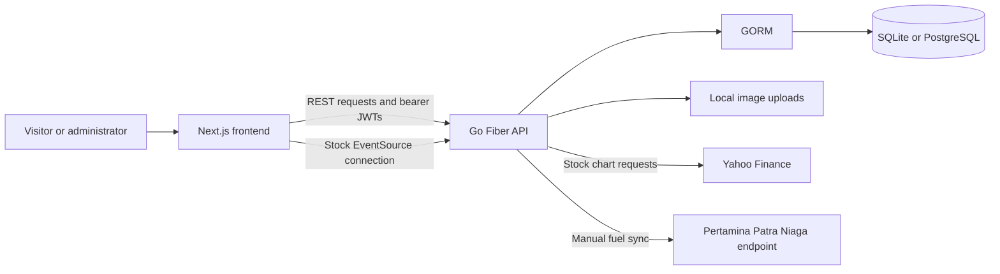

# Codebase Summary — Petronesia Enterprise Portal

Analysis date: 3 November 2026 (Asia/Jakarta).

> Historical snapshot from before deployment preparation. Startup seeding, demo fallbacks, upload storage, and validation findings below have since changed. See [DEPLOYMENT_PLAN.md](DEPLOYMENT_PLAN.md) for the implemented deployment design and runbook.

## 1. Project overview

This repository contains an Indonesian energy company profile website with a separate administration portal and REST API. The backend and repository documentation call the product **Petronesia**, while much of the public website, metadata, seed content, and fallback content uses **PT Pertamina (Persero)** branding.

The application combines corporate information, business and sustainability pages, news/events, vacancies, contact submissions, regional fuel prices, and investor relations. Administrators can manage website content, events, jobs, and uploaded images.

The main corporate and content management flows are implemented. Several features retain demonstration data or incomplete integration, and the frontend currently fails the type and lint checks described below. This document describes the checked-in implementation; it does not verify external corporate claims, current prices, or upstream service availability.

## 2. Technology stack

Versions below are declared in the repository manifests, rather than independently verified release information.

| Layer | Technologies | Primary source |
| --- | --- | --- |
| Frontend | Next.js 16.3.6, React/React DOM 19.2.8, TypeScript 5 | `frontend/package.json` |
| Styling and interaction | Tailwind CSS 4, Framer Motion, GSAP, Lucide icons | `frontend/package.json`, `frontend/src/app/globals.css` |
| API client | Axios, browser Fetch, EventSource for stock updates | `frontend/src/lib/api.ts`, `frontend/src/components/investor/RealtimeStockChart.tsx` |
| Backend | Go 1.26.0, Fiber v2, GORM | `backend/go.mod` |
| Persistence | SQLite by default; PostgreSQL supported | `backend/config/database.go` |
| Authentication | bcrypt password hashes, signed JWTs, database token versions | `backend/controllers/authController.go`, `backend/utils/jwt.go` |
| Deployment | Multi-stage Dockerfiles, Docker Compose, backend Render configuration | `docker-compose.yml`, `render.yaml` |

## 3. Repository structure

```text
companyProfileProject/
├── README.md                         # Setup and Docker instructions
├── .env.example                      # Example environment configuration
├── docker-compose.yml                # Frontend/backend services and volumes
├── render.yaml                       # Backend deployment definition
├── INVESTOR_RELATIONS_DESIGN_ANALYSIS.md
├── docs/superpowers/plans/            # Existing Docker implementation plan
├── backend/
│   ├── main.go                       # Application startup and global middleware
│   ├── config/database.go            # DB selection, auto-migration, seed data
│   ├── routes/routes.go              # Public and protected API routes
│   ├── controllers/                  # Request handlers and market-data services
│   ├── models/                       # Seven database models
│   ├── middlewares/                  # JWT protection and an unused bot guard
│   ├── utils/                        # JWT and asynchronous audit logging
│   ├── cmd/migrate/                  # Standalone migration/seed entry point
│   ├── uploads/                      # Uploaded images served at /uploads
│   └── api_test.go                    # API integration/security regression tests
└── frontend/
    ├── src/app/                      # App Router pages and global layout/styles
    ├── src/components/               # Shared navigation and feature components
    ├── src/lib/api.ts                # API helpers, types, and fallback datasets
    ├── src/lib/useSiteContent.ts     # CMS loading, browser cache, update broadcasts
    ├── src/proxy.ts                  # Admin redirects and security headers
    ├── public/                       # Images and robots.txt
    └── next.config.ts                # Standalone output and image settings
```

## 4. Architecture and data flow



- The frontend and backend run independently, normally on ports **3000** and **8080**.
- `NEXT_PUBLIC_API_URL` supplies the browser-facing API URL, defaulting to `http://localhost:8080/api`. Docker injects it during the frontend build.
- Public pages commonly load data on the client. API helpers provide built-in content, events, jobs, and fuel-price fallbacks when requests fail.
- `useSiteContent` starts with default copy, merges browser-cached content, then merges API content. It listens for storage changes and same-window CMS update events.
- The backend uses controllers directly against the shared GORM database connection. There is no separate service/repository layer for most CRUD operations.
- CMS and fuel endpoints maintain process-local caches. Stock requests use a process-local snapshot cache and `singleflight` to coalesce duplicate upstream requests.
- Image uploads live on the backend filesystem and are served through `/uploads`; the upload response includes an absolute URL derived from the request.

## 5. Frontend features and routes

| Area | Routes | Implemented behavior |
| --- | --- | --- |
| Home | `/` | Corporate landing page, CMS content, subholding explorer, AKHLAK showcase, ESG content, and fuel widget |
| Company profile | `/about`, `/about/akhlak`, `/about/vision-mission`, `/about/board-of-directors` | Company background, values, leadership, and vision/mission |
| Business | `/business` and `/business/{upstream,refining,retail,gas,marine-logistics,new-renewable-energy}` | Business and subholding information |
| Sustainability | `/sustainability`, `/sustainability/net-zero-2060`, `/sustainability/desa-energi-berdikari` | ESG, energy transition, and community information |
| News/events | `/events`, `/events/[slug]` | Search/category listing, pagination, article details, related articles, and backend view counting |
| Careers | `/careers` | Vacancy listing and detail modal; quick application form currently changes local UI state only |
| Investor relations | `/investor-relations` | Hardcoded financial/report information, external report links, stock chart, and API-backed contact form |
| Contact | `/contact` | Contact details and API-backed inquiry submission |
| Administration | `/admin/login`, `/admin/dashboard`, `/admin/content`, `/admin/events`, `/admin/jobs` | Authentication, metrics, CMS editing, event/job CRUD, and image uploads |

Shared components provide the navigation, footer, logo, badges, and scroll-to-top behavior. The root layout configures Indonesian language metadata and Google-hosted fonts. The visual system uses white/slate surfaces, navy sections, and blue/red/green brand accents.

## 6. Backend API surface

All routes below use the `/api` prefix unless otherwise stated.

| Access | Endpoints | Purpose |
| --- | --- | --- |
| Public | `GET /` outside `/api` | Basic application status metadata |
| Public | `POST /auth/login` | Admin login and JWT issuance |
| Public | `GET /events`, `GET /events/:slug` | Published news/events and detail |
| Public | `GET /jobs`, `GET /jobs/:slug` | Active vacancy listing; detail accepts slug or numeric ID |
| Public | `GET /content`, `GET /content/:section` | CMS content as records and key/value maps |
| Public | `POST /contact` | Validate and store contact inquiries |
| Public | `GET /stocks/:symbol`, `GET /stocks/stream` | Stock snapshots and Server-Sent Events |
| Public | `GET /fuel-prices`, `/fuel-prices/regions`, `/fuel-prices/sync-status` | Prices, region groups, and sync status |
| Admin JWT | `GET /admin/me`, `POST /admin/logout`, `PUT /admin/password`, `POST /admin/register` | Identity, token revocation, password changes, and account creation |
| Admin JWT | `GET /admin/stats`, `GET /admin/audit-logs` | Dashboard counts and audit records |
| Admin JWT | `GET/POST /admin/events`, `PUT/DELETE /admin/events/:id` | Event management |
| Admin JWT | `GET/POST /admin/jobs`, `PUT/DELETE /admin/jobs/:id` | Vacancy management |
| Admin JWT | `GET/POST/PUT /admin/content`, `PUT/DELETE /admin/content/:key` | Read/create/batch-update/update/delete CMS entries |
| Admin JWT | `POST /admin/upload`, `GET /admin/contacts` | Image uploads and latest 50 contact messages |
| Admin JWT | `PUT /admin/fuel-prices/:id`, `POST /admin/fuel-prices/sync` | Manual price edits and upstream synchronization |

Responses generally use `success`, `message`, and/or `data`, with pagination metadata where applicable. Request throttling exists for login, contact, public content reads, stock requests/streams, and fuel reads.

## 7. Database and authentication

| Model | Main responsibility |
| --- | --- |
| `Admin` | Unique username, hidden password hash, role, token version, timestamps |
| `Event` | Unique slug, article body, category, publication state/date, image, views, author ID |
| `JobVacancy` | Unique slug, department, location, employment type, requirements, deadline, active flag |
| `SiteContent` | Unique content key, section, label, type, value |
| `ContactMessage` | Sender details, message, read flag, creation time |
| `AuditLog` | Actor, action, resource, target, IP, user agent, details, timestamp |
| `FuelPrice` | Unique province/fuel combination, zone, product details, tax tier, price, effective date |

Startup selects PostgreSQL through `DATABASE_URL`, or through explicit host/user settings when SQLite is not selected. If a PostgreSQL connection fails, startup falls back to SQLite. GORM automatically migrates the seven models and seeds empty datasets, including a default administrator, example events/jobs/content, and fuel prices covering 38 provinces plus two free-trade regions.

The initial administrator uses `ADMIN_INITIAL_PASSWORD`, falling back to the documented demonstration password `admin123`. JWTs expire after 24 hours. Backend protection validates the token and checks the administrator's database token version. Logout and password changes increment that version, invalidating existing sessions for that account.

The browser stores the JWT in both localStorage and a JavaScript-written cookie. The Next.js proxy checks cookie presence for admin navigation; the API performs actual token validation. Roles are stored, but the protected route group does not enforce separate superadmin permissions.

## 8. External data integrations

**Stocks:** The backend allowlists `PGEO` and `PGAS`, translates them to Yahoo Finance symbols, validates supported ranges, bounds upstream response size/time, caches snapshots, and can serve stale data within a configured limit. SSE connections have per-IP/global caps, heartbeat messages, and a maximum lifetime. A polling function defines 15-second polling while the market is open and five-minute polling otherwise.

**Fuel prices:** A sync handler requests the configured Pertamina Patra Niaga content endpoint and parses regional prices. A worker function defines an initial sync followed by two-hour checks. Failed upstream retrieval can apply hardcoded tier prices with an October 2026 effective period.

**Runtime integration gap:** Neither `StartStockPoller()` nor `StartFuelPriceSyncWorker()` is called from the backend startup or routes. Consequently, the normal entry point does not activate periodic stock broadcasts or automatic fuel synchronization. REST stock retrieval, the initial SSE frame, and manual fuel synchronization have their own handler paths. The fuel status object nevertheless initializes with `auto_scheduler_active: true` and a successful status.

## 9. Configuration and running the project

### Docker

From the project root:

```bash
cp .env.example .env
# Set deployment-specific secrets and configuration in .env.
docker compose up --build -d
```

The frontend is available at `http://localhost:3000`; the API is at `http://localhost:8080/api`. Compose waits for a successful backend fuel-price health check before starting the frontend. Named volumes preserve the SQLite database and uploads across container replacement. Both runtime images run as non-root users.

### Local development

In separate terminals:

```bash
cd backend
go run main.go
```

```bash
cd frontend
npm ci
npm run dev
```

The backend's normal entry point loads `.env` from its current working directory. Therefore, a root `.env` used by Compose is not automatically loaded when running `go run main.go` from `backend/`; export the required variables or supply a backend-local `.env`.

| Variable | Usage |
| --- | --- |
| `NEXT_PUBLIC_API_URL` | Browser API base URL; supplied at frontend build time |
| `FRONTEND_PORT`, `BACKEND_PORT` | Compose host port mappings |
| `PORT` | Backend listen port; defaults to 8080 |
| `APP_ENV`, `JWT_SECRET` | Production mode and token signing secret; an empty production secret prevents startup |
| `DATABASE_URL` | Preferred direct PostgreSQL connection string |
| `DB_TYPE`, `SQLITE_FILE` | SQLite selection and database file path |
| `DB_HOST`, `DB_PORT`, `DB_USER`, `DB_PASSWORD`, `DB_NAME`, `DB_SSLMODE` | Individual PostgreSQL settings |
| `ADMIN_INITIAL_PASSWORD` | Initial seeded admin password, used only when the admin table is empty |

Compose currently omits `DATABASE_URL`, `DB_SSLMODE`, and `ADMIN_INITIAL_PASSWORD` from the backend environment mapping. Adding them only to the root `.env` does not pass them into that container. The Render definition configures only the backend and contains no persistent disk declaration for uploads or a fallback SQLite database.

## 10. Validation and test coverage

The repository includes backend API integration tests and stock-controller unit tests. The API tests cover public content/jobs, admin login/content updates, selected input validation, audit-log access, logout revocation, and production JWT secret enforcement. Stock unit tests cover symbol/range rejection and SSE hub limits/broadcast behavior.

Checks performed for this analysis:

| Check | Result |
| --- | --- |
| Backend `go test ./...` with a temporary SQLite database and isolated environment | Passed for all packages; API integration tests and stock-controller unit tests succeeded |
| Frontend `tsc --noEmit --incremental false` | Failed: `next.config.ts:5` declares `eslint`, which is not a property of the installed `NextConfig` type |
| Frontend `npm run lint` | Failed: 71 findings, consisting of 28 errors and 43 warnings |

Lint findings include explicit `any` types and React hook/state patterns. No frontend test script, frontend test files, or CI workflow was found in the inspected repository. A production build, browser walkthrough, live upstream requests, Docker deployment, and PostgreSQL integration run were not performed.

## 11. Main findings and improvement priorities

### Immediate correctness and deployment concerns

1. **Resolve frontend validation failures.** Correct the unsupported Next.js configuration and address lint errors before treating the frontend build pipeline as healthy. Sources: `frontend/next.config.ts`, frontend validation results above.
2. **Activate background integrations deliberately.** Start and manage the stock poller and fuel worker, and derive sync status from actual execution. Their current status/comments overstate what startup enables. Sources: `backend/main.go`, `backend/controllers/{stock_controller,fuel_controller}.go`.
3. **Align the CSP with deployment configuration.** `connect-src` permits localhost and Pertamina subdomains but does not include an arbitrary configured API origin. A separately hosted API can therefore be blocked by the browser. Source: `frontend/src/proxy.ts`.
4. **Remove demonstration credentials from production defaults.** Admin seeding has a known password fallback, and Compose has a known JWT secret fallback. Pass explicit deployment secrets and the initial admin password into the container. Sources: `backend/config/database.go`, `docker-compose.yml`.
5. **Make persistence failures visible.** Falling back from a failed production PostgreSQL connection to SQLite can create an unexpected separate dataset. Render also needs an explicit storage strategy for uploaded files. Sources: `backend/config/database.go`, `render.yaml`.

### Security and data integrity concerns

6. **Allowlist event ordering.** The public event list passes the `order` query parameter directly to GORM `Order`. Restrict it to supported column/direction combinations instead of accepting SQL order expressions. Source: `backend/controllers/eventController.go`, `GetEvents`.
7. **Strengthen session and authorization boundaries.** Tokens are readable by JavaScript, and admin creation is available to any authenticated admin without a superadmin check. Review cookie-based session handling and explicit role permissions. Sources: admin login page, `backend/middlewares/authMiddleware.go`, `backend/controllers/authController.go`.
8. **Unify validation and visibility rules.** Strict CMS key/value validation exists on creation but is not consistently applied to batch/single updates. Job detail lookup does not filter inactive vacancies even though the public list does. Sources: `backend/controllers/content_controller.go`, `backend/controllers/job_controller.go`.
9. **Validate uploaded image content.** Uploads enforce an extension allowlist and a nominal 5 MB check, but do not inspect image signatures or decode file contents. Source: `backend/controllers/upload_controller.go`.

### Product completeness and maintainability

10. **Complete the career application flow.** The quick application form reports success by setting component state; there is no application model or submission endpoint. Also, an empty API vacancy list leaves the initial fallback jobs visible. Source: `frontend/src/app/careers/page.tsx`.
11. **Distinguish fallback content from live data.** Frontend helpers silently substitute demonstration datasets. Fuel fallback synchronization can report success after applying fixed October 2026 prices. Expose data origin, age, and retrieval failure clearly. Sources: `frontend/src/lib/api.ts`, `backend/controllers/fuel_controller.go`.
12. **Align API contracts.** `fetchJobs` sends `q`, while the backend reads `search`. `fetchSiteContent(section)` sends a query parameter to `/content`, while the backend's section filter is implemented at `/content/:section`. Sources: frontend API helpers and backend job/content controllers.
13. **Reduce duplication and oversized modules.** The CMS admin page is about 2,000 lines, while `api.ts` mixes roughly 1,000 lines of API code and static datasets. Separate feature components, static content, and shared admin/auth behavior as the product grows.
14. **Expand targeted verification.** Add coverage for worker startup, inactive vacancy access, request/response contracts, fallback provenance, and frontend user journeys. Keep backend integration tests isolated from the default on-disk database; the existing setup calls the normal migration/seeding function.

Additional observations: `BotGuard` is defined but not registered; event CRUD handlers do not call the audit helper even though job/content handlers do; caches and rate limits are local to each process. These matter when evaluating claimed protections or moving to multiple backend replicas.

## 12. Suggested entry points for future work

- **Understand startup and persistence:** `backend/main.go`, `backend/config/database.go`.
- **Understand the API contract:** `backend/routes/routes.go`, then the corresponding controller.
- **Change public CMS behavior:** `frontend/src/lib/useSiteContent.ts`, `frontend/src/lib/api.ts`, `frontend/src/app/admin/content/page.tsx`.
- **Change authentication:** backend auth controller/middleware/JWT utility, frontend admin login/dashboard, and `frontend/src/proxy.ts`.
- **Change market data:** stock/fuel controllers, `RealtimeStockChart.tsx`, and `FuelPriceWidget.tsx`.
- **Change deployment:** both Dockerfiles, `docker-compose.yml`, `.env.example`, and `render.yaml`.

This analysis added documentation only; it did not modify application source code or configuration.
